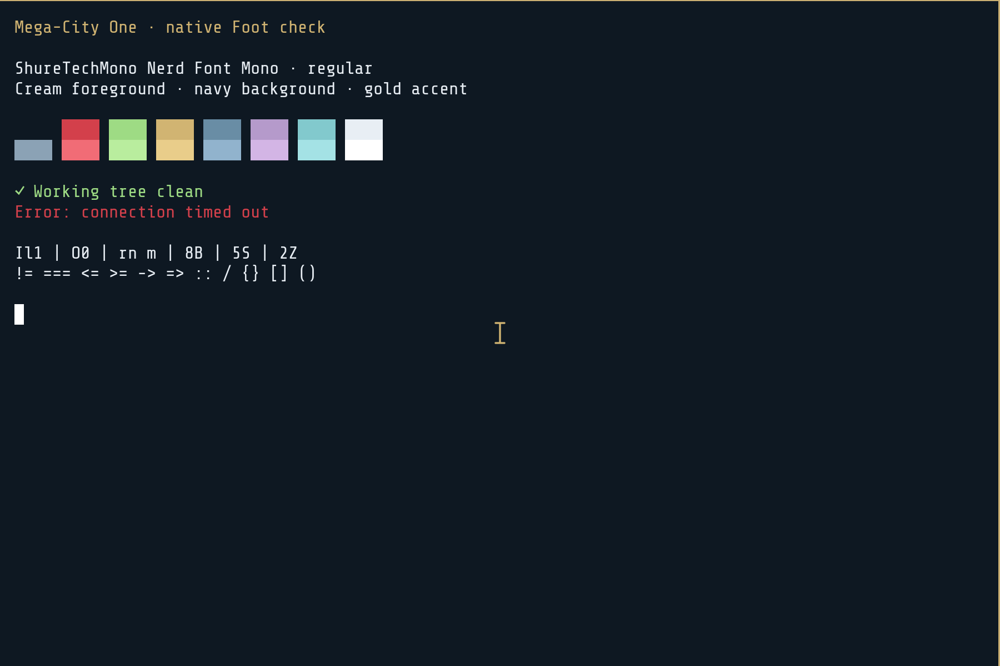

# Drokk

A dark navy, cream and gold Omarchy theme with city artwork, Share Tech type,
an eagle emblem and optional desktop companions.



**Status:** working on our ARM64 Omarchy dev setup. Intel/AMD validation is pending.

**Installation:** this repository contains development source. It is not yet a
one-command Omarchy theme install. Companions, window cards and the SDDM login
screen are separate optional components.

## Build

```sh
mise install
mise run theme:build
mise run theme:check
```

## Documentation

- [Compatibility and current status](docs/live-feature-status.md)
- [Build and package layout](docs/package-workflow.md)
- [Optional companions and recovery](docs/companions.md)
- [Window card and hyprpm](docs/window-card.md)
- [Lock and login](docs/authentication-screens.md)

Original code: [0BSD](LICENSE). Original artwork: [CC0](ARTWORK-LICENSE.md).
Bundled third-party material retains its [own licences](THIRD-PARTY-NOTICES.md).
